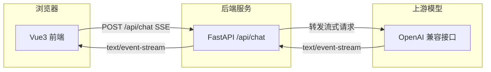
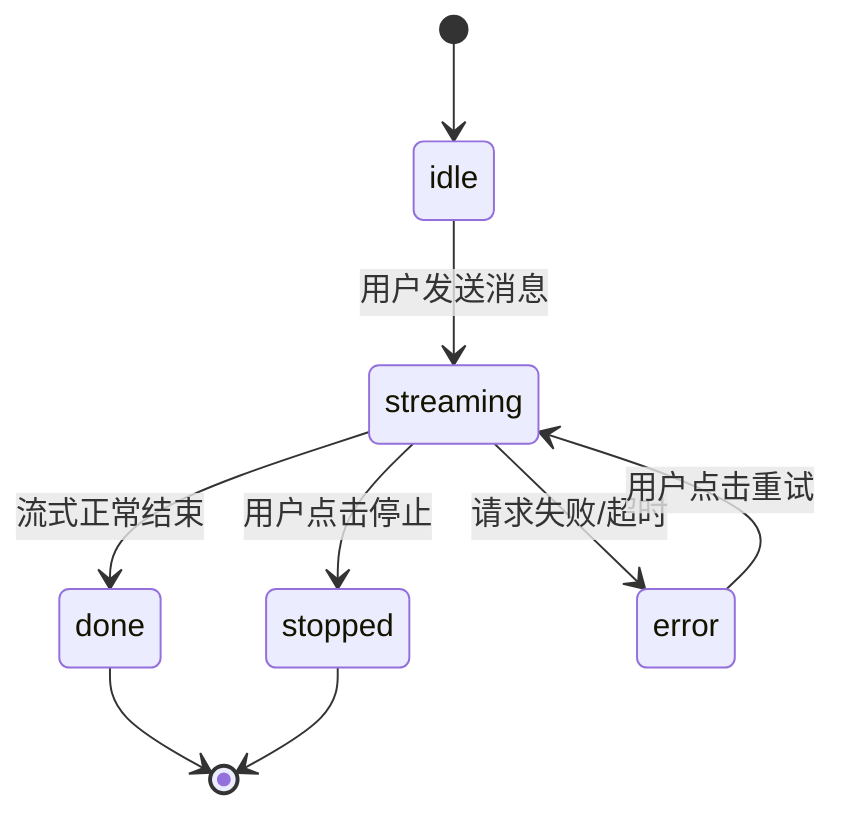
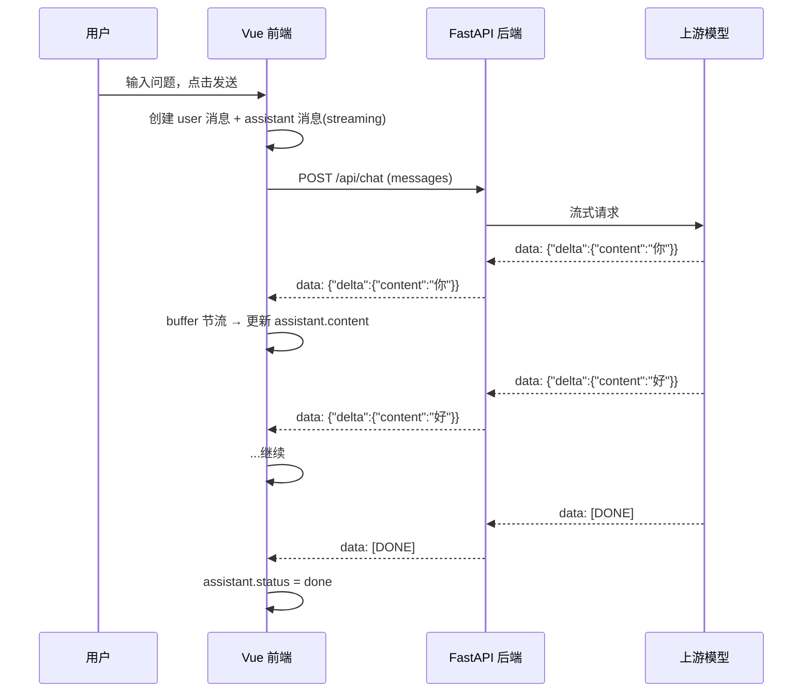
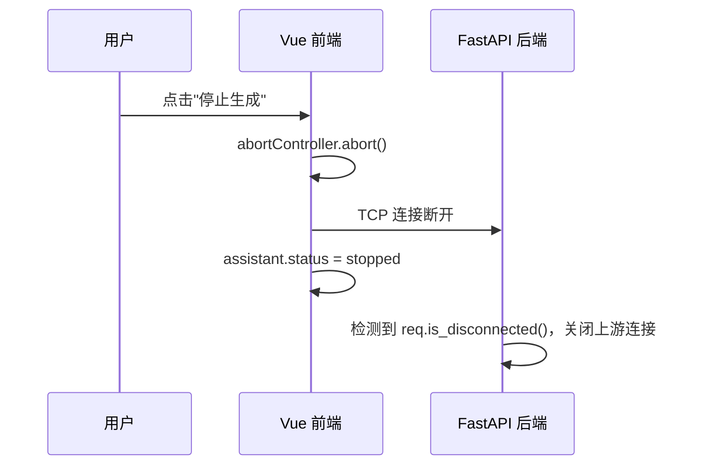
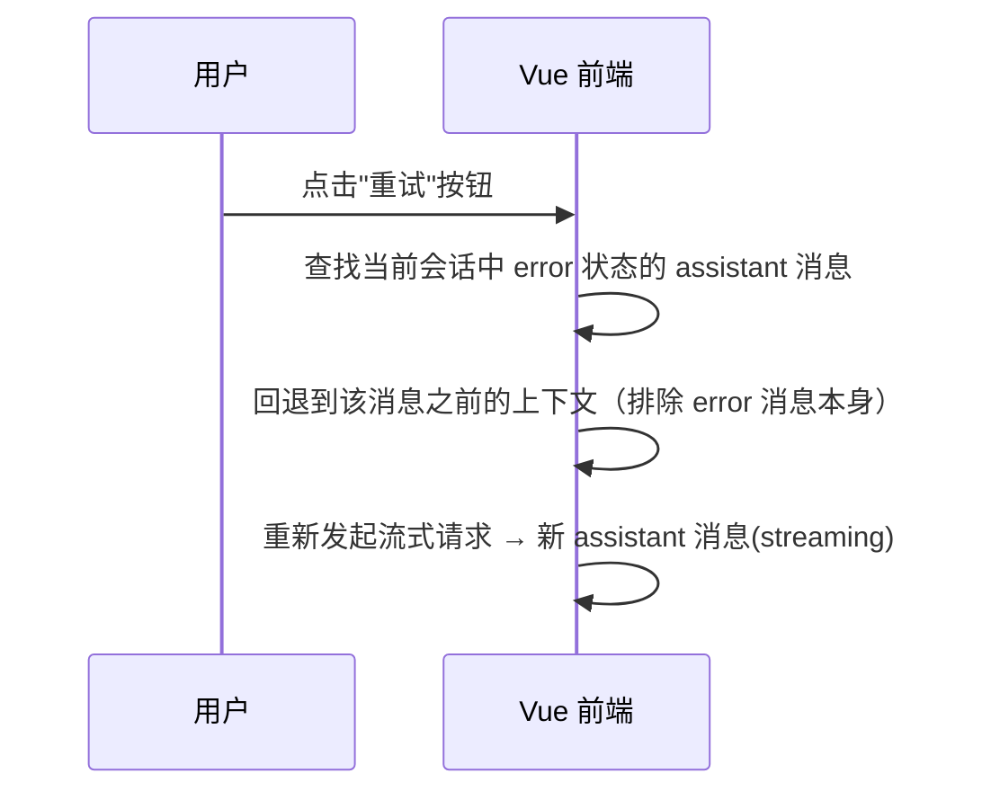

# 技术文档问答助手

> 分阶段交付的 AI 应用项目。当前版本：**v1.0**（P0 · MVP 聊天壳已交付，2026-11-09）。
> 完整需求见 [docs/需求文档-技术文档问答助手.md](docs/需求文档-技术文档问答助手.md)。

---

## 项目简介

一个面向技术文档场景的 AI 问答助手。用户可以基于文档内容提问，获得带引用来源的流式回答。项目分三阶段交付：

| 阶段 | 功能范围 | 状态 |
| --- | --- | --- |
| P0 · MVP | 流式聊天壳、停止生成、多轮上下文、错误重试、Markdown 渲染、会话管理 | ✅ 已完成（v1.0） |
| P1 · RAG | 文档上传解析、向量化检索、引用来源卡片、降级 UI | ⚪ 未开始 |
| P2 · Agent | Function Calling、工具调用中间态、Human-in-the-loop | ⚪ 未开始 |

---

## 架构总览

前后端分离架构。前端只与自己的后端通信，API Key 始终只存在于后端环境变量中。



---

## 项目目录结构

```
AssistantOfWord/
├── README.md
├── docs/
│   └── 需求文档-技术文档问答助手.md
├── frontend/                    # Vue3 前端
│   ├── package.json
│   ├── vite.config.ts
│   ├── tsconfig.json
│   ├── index.html
│   ├── .env.example
│   └── src/
│       ├── main.ts
│       ├── App.vue
│       ├── api/
│       │   └── chat.ts          # 流式请求封装
│       ├── stores/
│       │   └── chat.ts          # Pinia 会话 & 消息状态
│       ├── utils/
│       │   ├── stream.ts        # ReadableStream 解析工具
│       │   └── storage.ts       # localStorage 封装
│       ├── types/
│       │   └── index.ts         # 数据模型类型定义
│       ├── components/
│       │   ├── ConversationList.vue   # 左侧会话列表
│       │   ├── MessageStream.vue      # 中间消息流
│       │   ├── ChatInput.vue          # 底部输入区
│       │   ├── MessageItem.vue        # 单条消息（含状态按钮）
│       │   └── MarkdownView.vue       # Markdown 渲染
│       └── styles/
│           └── global.css
└── backend/                     # FastAPI 后端
    ├── requirements.txt
    ├── .env.example
    └── app/
        ├── __init__.py
        ├── config.py            # 环境变量 & 配置
        ├── routers/
        │   ├── __init__.py
        │   ├── chat.py          # /api/chat 流式接口
        │   └── health.py        # /api/health
        └── services/
            └── llm.py           # 上游模型调用 & 流式转发
```

---

## 前端设计（P0）

### 技术选型

| 类别 | 选型 | 理由 |
| --- | --- | --- |
| 框架 | Vue3 + Vite + TypeScript | 需求明确 |
| 状态管理 | Pinia | Vue3 官方推荐，TS 支持好 |
| UI 组件库 | Element Plus | 生态成熟、组件齐全、文档丰富，社区案例多 |
| Markdown | markdown-it + highlight.js | markdown-it 社区成熟，highlight.js 支持 190+ 语言 |
| HTTP | 原生 fetch | 流式场景下比 axios 更合适，可直接拿到 ReadableStream |
| 中断 | AbortController | fetch 原生支持 |

### 消息状态机

每条助手消息有 5 种状态，UI 根据状态渲染不同操作按钮：



| 状态 | 含义 | UI 表现 |
| --- | --- | --- |
| `idle` | 尚未请求 | 占位，一般不会在列表中持久存在 |
| `streaming` | 流式生成中 | 显示打字光标 / 停止按钮，输入框禁用发送 |
| `done` | 正常完成 | 显示复制按钮 |
| `stopped` | 用户中断 | 保留已生成内容，显示重新生成按钮 |
| `error` | 失败可重试 | 显示错误提示 + 重试按钮 |

### Pinia Store 设计

```ts
// stores/chat.ts（核心结构）

interface ChatStore {
  conversations: Conversation[]      // 所有会话
  activeConversationId: string | null // 当前激活会话 ID
  abortController: AbortController | null // 当前请求的中断控制器
}
```

核心 Action：

| Action | 职责 |
| --- | --- |
| `createConversation()` | 新建会话，自动激活 |
| `deleteConversation(id)` | 删除会话 |
| `switchConversation(id)` | 切换当前会话 |
| `sendMessage(content)` | 发起流式请求，创建 user 消息和 assistant 消息（status=streaming） |
| `stopGeneration()` | 调用 `abortController.abort()`，消息状态改为 stopped |
| `retryMessage(messageId)` | 原地重发该消息（携带相同上下文） |
| `clearConversation(id)` | 清空会话消息但保留会话 |

### 核心组件

```
App.vue
├── 顶部 Header（项目名 / 模型标识 / 清空入口）
├── 左侧 ConversationList.vue
└── 主区域
    ├── MessageStream.vue（中间滚动区）
    │   └── v-for MessageItem.vue
    │       └── MarkdownView.vue（仅 assistant 消息）
    └── ChatInput.vue（底部：输入框 + 发送/停止按钮）
```

**MessageItem.vue** 根据消息角色渲染不同样式；assistant 消息额外根据 `status` 渲染停止、重试、复制等按钮。

### 流式请求实现

工具函数 `utils/stream.ts` 封装核心解析逻辑：

```
fetch → response.body.getReader() → 循环 read()
  ↓
TextDecoder 解码 → 追加到 buffer
  ↓
按 \n 拆分 → 逐行处理
  ↓
跳过空行 / event: 行
  ↓
data: [DONE] → 结束
  ↓
data: {json} → 解析 → 提取 choices[0].delta.content → 回调
```

关键细节：
- **必须保留 buffer**，因为每次 `read()` 返回的 chunk 可能在一行中间被截断，不能假设每次 read 都是完整行。
- 解析到 `data: [DONE]` 时触发结束回调，关闭 ReadableStream。
- 捕获 `AbortError`：如果是用户主动中断（`abortController.abort()`），视为正常停止，不标记 error。

### Markdown 渲染与节流

流式渲染会导致高频重渲染，需要节流策略：

1. **节流更新**：stream 回调不直接改 store，而是累计到一个本地 buffer，通过 `setInterval`（比如 30ms）或 `requestAnimationFrame` 周期性同步到 store。
2. **分段渲染**：markdown-it 每次 render 都会全量重新渲染，但因为 Markdown 源码只增不减，实际 DOM diff 由 Vue 的虚拟 DOM 处理，不会整页重排。
3. **代码块闪烁**：流式中代码块未闭合时 `markdown-it` 可能渲染异常，接受轻微不完美；停止后最终状态一次渲染即可恢复正常。

### 会话持久化

MVP 用 localStorage 存储，key 为 `aow:conversations`（当前激活会话 ID 为 `aow:active-conversation-id`）。store 中每次会话变更后调用 `saveConversations` 序列化写入；store 初始化时读取恢复，并将遗留的 `streaming`/`idle` 状态收尾为 `stopped`，避免刷新后出现僵尸消息。

---

## 后端设计（P0）

### 技术选型

| 类别 | 选型 | 理由 |
| --- | --- | --- |
| 框架 | FastAPI | 原生 async，自动 OpenAPI 文档，SSE 支持好 |
| HTTP 客户端 | httpx | 支持异步 + 流式读取，与 FastAPI 配合完美 |
| 上游对接 | OpenAI 兼容接口 | 灵活切换不同模型服务商 |

### 核心实现

#### `app/config.py`

从 `.env` 读取：
- `OPENAI_API_KEY`：上游 API 密钥
- `OPENAI_BASE_URL`：上游 base URL（默认 `https://api.openai.com/v1`）
- `OPENAI_MODEL`：模型名称（默认 `gpt-4o-mini`）
- `CORS_ORIGINS`：允许的前端来源（逗号分隔）

后端通过 `OPENAI_BASE_URL` 拼接 `/chat/completions`，调用的是 OpenAI 兼容协议，因此**无需改任何 Python 代码即可切换模型服务商**。`.env.example` 中已预置 DeepSeek、OpenAI、通义 DashScope、硅基流动、月之暗面 五家配置块，切换时只需注释/取消注释对应块。

#### `app/services/llm.py`

封装上游调用：
- 接收 `messages` 列表，通过 httpx 以 `stream=True` 发起请求
- 逐行读取上游 SSE，用 `StreamingResponse` 原样转发给前端
- 上游返回 `data: [DONE]` 时结束流
- 客户端断开时 httpx 的 context manager 自动处理资源清理

#### `app/routers/chat.py`

```python
@router.post("/api/chat")
async def chat(request: ChatRequest, req: Request):
    # 1. 校验 messages 格式
    # 2. 调用 llm.service.stream_chat(messages)
    # 3. 返回 StreamingResponse，media_type="text/event-stream"
    # 4. 监听 req.is_disconnected() 处理客户端主动断开
```

错误处理：
- 上游 429 → 返回 `{"error": {"code": "RATE_LIMITED", "message": "..."}}`
- 上游 401 → 返回 `{"error": {"code": "UNAUTHORIZED", "message": "..."}}`
- 上游 5xx / 网络异常 → 返回 `{"error": {"code": "UPSTREAM_ERROR", "message": "..."}}`
- 所有错误以非流式 JSON 返回（不是 SSE），前端据此区分。

---

## 核心流程

### 发送消息（正常路径）



### 停止生成



### 重试



---

## 接口契约

### `POST /api/chat`（流式）

**请求体**：

```json
{
  "messages": [
    { "role": "user", "content": "什么是闭包？" }
  ]
}
```

**响应**：`Content-Type: text/event-stream`

```text
data: {"choices":[{"delta":{"content":"闭"}}]}
data: {"choices":[{"delta":{"content":"包"}}]}
data: [DONE]
```

**错误响应**（非流式 JSON）：

```json
{ "error": { "code": "RATE_LIMITED", "message": "请求过于频繁，请稍后重试" } }
```

若流式传输已开始后上游才出错，后端以错误事件收尾（前端解析到 `error` 字段即视为失败）：

```text
data: {"error": {"code": "UPSTREAM_ERROR", "message": "无法连接上游服务"}}
```

错误码枚举：

| code | 含义 |
| --- | --- |
| `RATE_LIMITED` | 上游限流 |
| `UNAUTHORIZED` | 鉴权失败 |
| `UPSTREAM_ERROR` | 上游 5xx 或网络异常 |
| `INVALID_REQUEST` | 请求体校验失败 |

### `GET /api/health`

```json
{ "status": "ok" }
```

---

## 数据模型

```ts
// types/index.ts

type MessageRole = 'user' | 'assistant' | 'system'

interface Message {
  id: string                          // uuid
  role: MessageRole
  content: string
  status: 'idle' | 'streaming' | 'done' | 'stopped' | 'error'
  error?: { code: string; message: string }
}

interface Conversation {
  id: string                          // uuid
  title: string                       // 自动取首条 user 消息前 20 字
  messages: Message[]
  createdAt: number                   // 时间戳 ms
  updatedAt: number
}
```

---

## 部署方案

### 前端

- 构建：`vite build` → `dist/`
- 部署：Vercel / Netlify / GitHub Pages
- 环境变量：`VITE_API_BASE_URL` 指向后端地址

### 后端

- 依赖：`pip install -r requirements.txt`
- 启动：`uvicorn app.main:app --host 0.0.0.0 --port 8000`
- 部署：Render / Railway / Fly.io（免费层可用）
- 环境变量（必须配置，复制 `.env.example` 为 `.env`）：

```env
# —— DeepSeek（国内推荐，默认启用）——
OPENAI_API_KEY=sk-你的DeepSeek密钥
OPENAI_BASE_URL=https://api.deepseek.com/v1
OPENAI_MODEL=deepseek-chat
CORS_ORIGINS=https://your-frontend-domain.com

# —— 备选服务商（二选一注释启用）——
# OpenAI:          https://api.openai.com/v1            / gpt-4o-mini
# 通义 DashScope:  https://dashscope.aliyuncs.com/compatible-mode/v1 / qwen-plus
# 硅基流动:        https://api.siliconflow.cn/v1        / deepseek-ai/DeepSeek-V3
# 月之暗面:        https://api.moonshot.cn/v1           / moonshot-v1-8k
```

> 完整五家服务商的 base URL / 模型名 / 控制台链接见 [`backend/.env.example`](./backend/.env.example)。

### 本地开发

```powershell
# 后端（Windows PowerShell）
cd backend
Copy-Item .env.example .env          # 填入真实 API Key
pip install -r requirements.txt
uvicorn app.main:app --reload --port 8000

# 前端（新终端）
cd frontend
Copy-Item .env.example .env          # VITE_API_BASE_URL=http://localhost:8000
npm install
npm run dev
```

### 本地模型（Ollama，v1.0 默认配置）

后端对接的是 OpenAI 兼容协议，因此可以直接把上游切到本地 Ollama，**无需改任何代码**：

```env
# backend/.env
OPENAI_API_KEY=ollama                # Ollama 不校验 Key，任意非空值即可
OPENAI_BASE_URL=http://localhost:11434/v1
OPENAI_MODEL=qwen3-vl:4b             # 换成本地已 pull 的任意模型
```

启动 Ollama 服务（`ollama serve`）后，模型列表用 `ollama list` 查看。若模型目录不在默认位置（`~/.ollama/models`），启动前需设置环境变量：

```powershell
$env:OLLAMA_MODELS = "E:\App\Ollama\models"   # 按实际路径修改
ollama serve
```

> v1.0 已在本地完成端到端验证：前端 → FastAPI → Ollama（qwen3-vl:4b）流式对话正常，切换回云端服务商只需改回 `.env` 三行配置。

---

## 关键决策记录

| 决策 | 选择 | 理由 |
| --- | --- | --- |
| UI 库 | Element Plus | 生态成熟、组件覆盖全、中文文档友好，遇到问题更容易找到解决方案 |
| 流式请求 | 原生 fetch | axios 对流式支持需要额外配置，fetch + ReadableStream 是浏览器原生方案 |
| 中断机制 | AbortController | fetch 原生支持，API 简洁 |
| 会话存储 | localStorage | MVP 阶段无需后端存储，localStorage 足够且实现简单 |
| Markdown 节流 | requestAnimationFrame 周期同步 | 30~50ms 一次，视觉上流畅且避免高频重渲染 |
| 重试策略 | 新建 assistant 消息，回退上下文 | 保留错误消息的历史可追溯性，用户能看到之前失败过 |
| 后端上游 SDK | httpx 直接调 OpenAI 兼容接口 | 灵活切换模型服务商，不需要绑定特定 SDK |

---

## v1.0 变更记录（2026-11-09）

| 变更 | 说明 |
| --- | --- |
| Ollama 本地模型接入 | `backend/.env` 切换至 `http://localhost:11434/v1`，后端代码零改动，验证了 OpenAI 兼容层的可移植性 |
| 修复流式 UI 卡加载 | Pinia store 中 push 进响应式数组后必须重新读取代理引用（`conv.messages[len-1]`）；沿用原始对象引用赋值不会触发视图更新，导致回复只有刷新后才可见 |
| 会话持久化 key 规范化 | 实际 key 为 `aow:conversations` / `aow:active-conversation-id`，恢复时收尾遗留 `streaming` 状态防止僵尸消息 |
| P0 端到端验证通过 | 发送 → 流式渲染 → 复制按钮 → 状态 `done` → localStorage 持久化，全链路在浏览器中验证 |

---

## P0 验收清单

- [x] 能发送问题并看到逐字流式回答（Ollama qwen3-vl:4b 端到端验证）
- [x] 停止按钮能真正中断请求，消息状态为 stopped（AbortController）
- [x] 多轮对话能记住上一轮内容（buildContext 携带历史消息）
- [x] 请求失败/限流时显示错误提示并可重试（上游断连场景已实测）
- [x] Markdown 与代码高亮正常，代码块可复制
- [x] API Key 不在前端出现（前端只与自有后端通信）
- [ ] 项目可部署，README 写清楚架构与启动方式（架构与启动方式已写清，云端部署待 P1 前完成）
- [x] 能闭卷解释流式解析中 buffer 的作用与 [DONE] 处理
